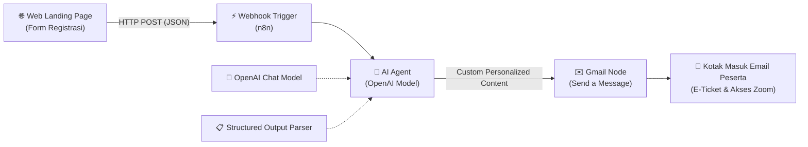

# 🎟️ AI-Powered Event Registration & Automated Email System with n8n

[](https://n8n.io/)
[](https://openai.com/)
[](https://workspace.google.com/)
[](https://developer.mozilla.org/)

Sistem otomatisasi registrasi acara (webinar/event) modern dan cerdas. Menggabungkan **Landing Page Flat UI**, **n8n Workflow Automation**, **OpenAI AI Agent** (dengan *Structured Output Parser*), dan **Gmail API** untuk mengirimkan e-ticket serta pesan sambutan yang dipersonalisasi secara otomatis langsung ke email pendaftar.

---

## 🌟 Arsitektur & Alur Kerja (Workflow)



1. **Frontend (User Input):** User mengisi nama lengkap, alamat email, nomor kontak, dan profesi pada landing page webinar.
2. **Webhook (n8n):** Data diteruskan secara real-time via REST API POST ke endpoint n8n.
3. **AI Agent + OpenAI:** AI memproses profil dan konteks pendaftar, menghasilkan pesan sapaan, tips khusus sesuai bidang/profesi peserta, dan format konten email yang dipersonalisasi melalui *Structured Output Parser*.
4. **Gmail Node:** Mengirimkan E-Ticket resmi berserta tautan webinar langsung ke inbox user.

---

## 📁 Struktur Direktori

```
.
├── index.html                     # Halaman landing page & form registrasi (Clean Flat UI)
├── style.css                      # Styling CSS modern, clean, dan fully responsive
├── script.js                      # Handler validasi form, switch mode test/prod, & fetch ke webhook
├── n8n_webinar_email_workflow.json# Template workflow n8n (bisa langsung diimpor)
├── .gitignore                     # Filter file yang tidak perlu di-commit
└── README.md                      # Dokumentasi & panduan proyek
```

---

## 🚀 Cara Menjalankan Proyek

### 1. Menjalankan Frontend
Cukup buka file `index.html` di browser favorit Anda, atau jalankan local server:
```bash
# Menggunakan Python
python -m http.server 3000

# Menggunakan Node / npx
npx serve .
```
Lalu akses `http://localhost:3000`.

### 2. Fitur Dual-Mode Webhook (Testing vs Production)
Pada bar atas landing page, tersedia switch mode:
- **Test Mode (`webhook-test`)**: Gunakan saat sedang menguji alur di n8n dengan tombol **"Listen for test event"**.
- **Production Mode (`webhook`)**: Gunakan saat workflow n8n sudah diaktifkan (**Active**).

---

## ⚙️ Setup n8n Workflow

1. Buka dashboard n8n Anda.
2. Buat workflow baru, klik menu **`...` (Options)** di pojok kanan atas -> pilih **Import from File...**.
3. Pilih berkas [`n8n_webinar_email_workflow.json`](n8n_webinar_email_workflow.json).
4. Sambungkan kredensial:
   - **OpenAI API Key**: Untuk node *OpenAI Chat Model*.
   - **Gmail OAuth2**: Untuk node *Send a message (Gmail)*.
5. Klik **Save** dan aktifkan toggle **Active** pada workflow.

---

## 🛠️ Tech Stack
- **Frontend**: Vanilla HTML5, CSS3 (Modern Flat Design), Vanilla JavaScript (ES6+).
- **Automation Engine**: [n8n](https://n8n.io/).
- **AI Core**: OpenAI Chat Model (GPT-4o / GPT-4o-mini) + LangChain AI Agent di n8n.
- **Output Formatting**: Structured Output Parser (JSON Schema).
- **Email Service**: Google Workspace / Gmail API OAuth2.

---

## 📄 Lisensi
Proyek ini dibuat untuk keperluan eksplorasi dan implementasi otomatisasi workflow. Bebas digunakan dan dimodifikasi (*MIT License*).
